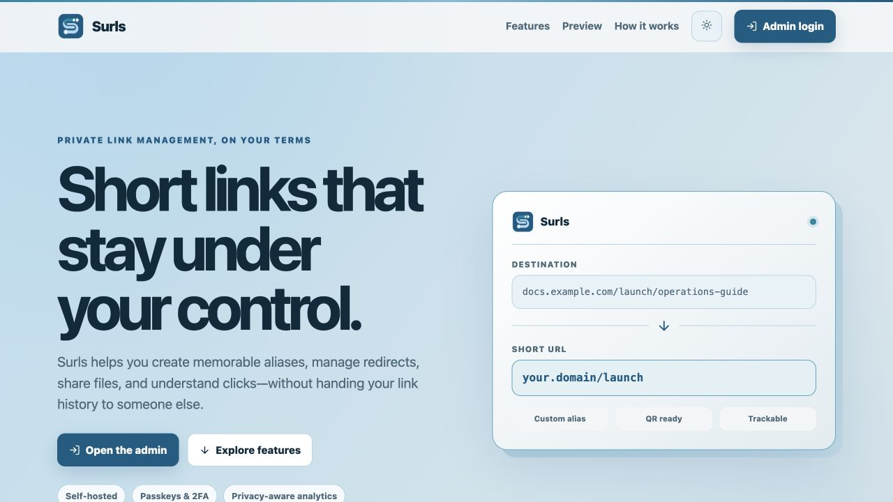
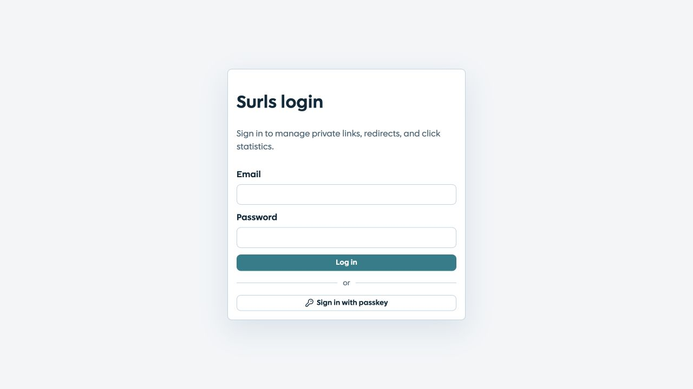
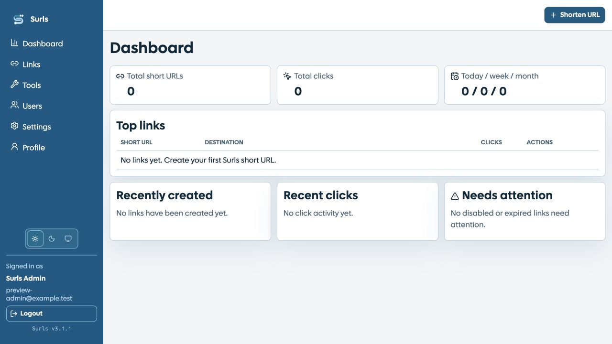
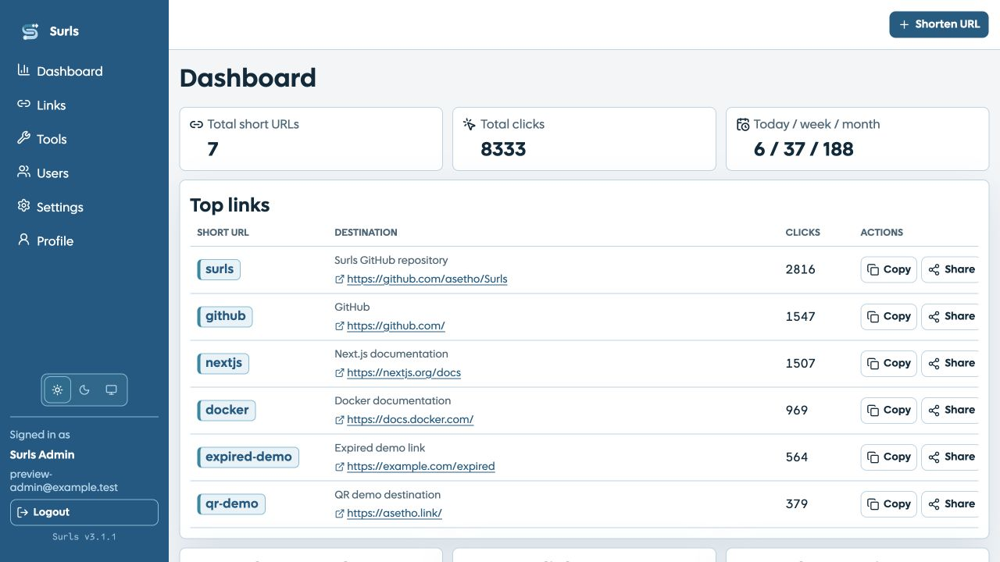
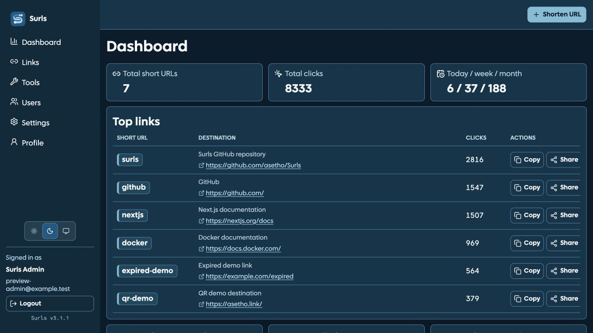
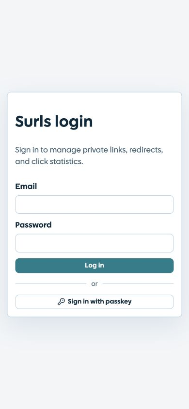
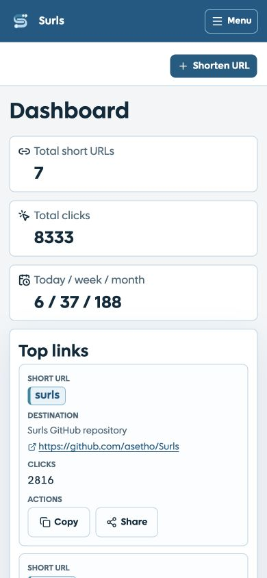
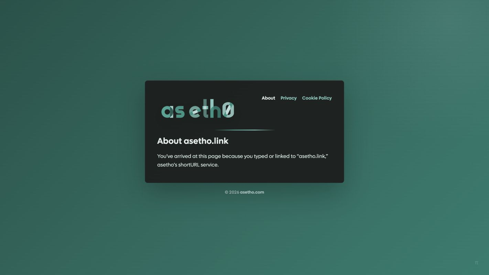
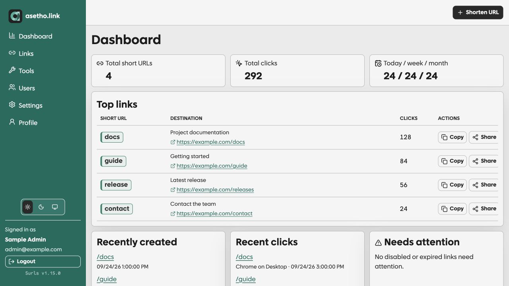
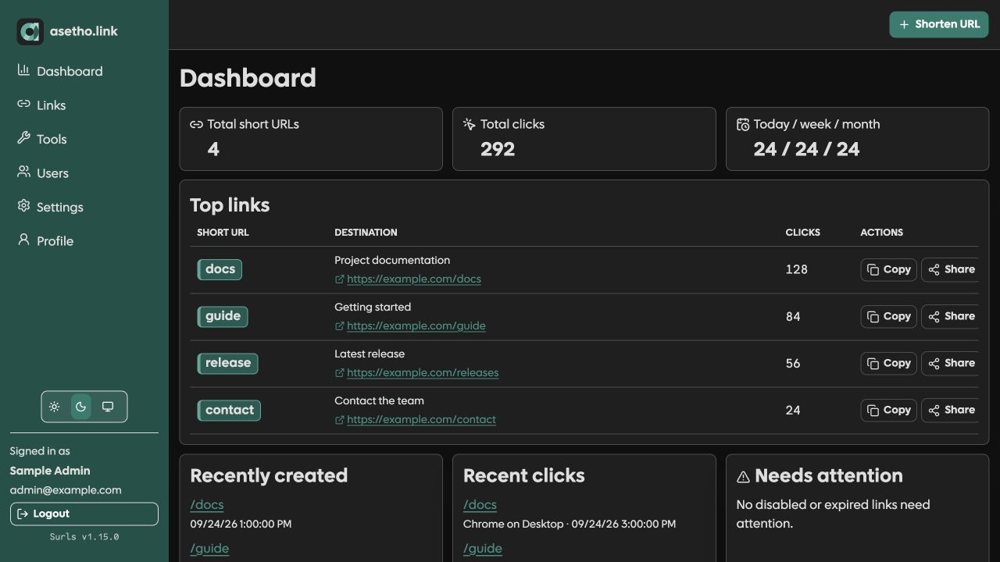

# Surls screenshot gallery

The included homepage, login, and dashboard screenshots were refreshed September 30, 2026 from a local checkout based on Surls **v3.1.1**. They show the real pages with the included Surls SVG mark, default palettes, and a disposable local database containing a fictional admin, links, and click history. The empty dashboard was captured before adding demo links. These are visual examples of the local preview, not evidence of a deployed upgrade.

The custom public example is the live homepage of [asetho.link](https://asetho.link/), captured separately. The custom admin examples use the light and dark palette values read from asetho.link's admin UI on the capture date, applied to the then-current local dashboard components with synthetic data. Its branding, public content, and custom palettes are owner-provided and are not bundled as the default Surls theme. No private admin data, credentials, or API tokens are included.

## Included public homepage

Shown when the public webroot has no `index.html`. This capture shows the first desktop viewport; the page continues with features and setup information.

## Included login

Default sign-in form, with password and passkey options. External sign-in buttons appear only after providers are configured.

## Fresh-install dashboard

The initial dashboard after creating the first admin, before adding any links. The pictured account is fictional.

## Default dashboard palettes

Sample links and click history make the same included UI easier to inspect. Light and dark modes are built in; no custom palette is applied. Each capture shows the first desktop viewport; recent activity continues below it.

The [SVG wordmark](../../assets/branding/surls-logo-horizontal.svg) and [SVG app icon](../../assets/branding/surls-app-icon.svg) are vector traces of the checked-in Surls artwork.

### Light

### Dark

## Included mobile layouts

Captured at a 390 × 844 CSS-pixel viewport. The dashboard image shows the top of the scrollable page.

| Login | Dashboard |
| --- | --- |
|  |  |

## Custom example: asetho.link

### Public homepage

An owner-controlled public homepage served through the custom webroot. See [public webroot configuration](../../README.md#public-webroot) for how to supply your own pages and assets.

### Custom admin colors: light

The custom palette changes the sidebar, buttons, link accents, panels, and status colors throughout the admin interface. These dashboard images use fictional accounts and example.com links. The screenshots show the first desktop viewport; recent activity continues below it.

### Custom admin colors: dark

The same dashboard with asetho.link's separately configured dark palette. Configure both palettes in **Settings → Dashboard theme → Open Theme Editor**; see [theme modes](../../README.md#theme-modes).

## Updating these images

- Capture the real included components and default palette at the version being documented. Use a disposable local installation or a render fixture with synthetic data for admin pages.
- Capture the custom example separately and identify its source; do not present owner branding as part of the default package.
- Verify fonts, icons, visible text, and desktop/mobile layout before saving images here. Keep account details, private URLs, tokens, and authentication setup codes out of captures.
- Update this page's version/date and captions, then check all Markdown image links. Keep capture scripts and temporary audit sites local; `visual-audit-preview/` is ignored.
